# Treise Continuous Governance, QA & Publishing Guide

This document establishes the permanent engineering, product evaluation, and QA architecture for **Treise**. It codifies **Tree of Thoughts (ToT) exploration**, **Prompt Chaining pipelines**, and **Recursive Self-Critique loops** to ensure the app maintains publishable Google Play Store production quality across all future development sessions.

---

## 1. The 5-Branch Tree of Thoughts (ToT) Evaluation Matrix

Whenever a feature, bug fix, layout refactor, or copy change is introduced, evaluate it across all 5 branches:

```mermaid
flowchart TD
    Root["Treise Production Quality Gate"] --> B1["Branch 1: Biomechanical Science & Load Engine"]
    Root --> B2["Branch 2: UX & 19 Design Heuristics"]
    Root --> B3["Branch 3: Data Resilience & Storage"]
    Root --> B4["Branch 4: Google Play Store & PWA"]
    Root --> B5["Branch 5: First-Time-to-Value & Onboarding"]

    B1 --> B1_1["E1RM & Multipliers (1.18x DB, 1.20x RDL)"]
    B1 --> B1_2["13 Strict Movement Families (No Cross-Contamination)"]
    B1 --> B1_3["Pure Bodyweight Progression (Reps & Pauses, 0kg)"]
    B1 --> B1_4["Israetel/Schoenfeld Volume Landmarks & Deloads"]

    B2 --> B2_1["Strict 12px Font Minimum Floor"]
    B2 --> B2_2["Zero Leaked UX/Engineering Jargon"]
    B2 --> B2_3["Single Canonical Entry Point Per Job"]
    B2 --> B2_4[">=44px Touch Targets & WCAG AA Contrast"]

    B3 --> B3_1["Zero-Crash Empty State (New User Simulation)"]
    B3 --> B3_2["Import/Export Full Backup Roundtrip"]
    B3 --> B3_3["Right-to-be-Forgotten Data Erasure"]

    B4 --> B4_1["PWA Manifest Standalone & Theme #060709"]
    B4 --> B4_2["Android 15 SDK Target >= 35"]
    B4 --> B4_3["Valid PNG IHDR Headers & Dimensions"]
    B4 --> B4_4["Mandatory Health & Non-Medical Disclaimer"]

    B5 --> B5_1["Automatic First-Visit Launch"]
    B5 --> B5_2["4-Step Wizard Under 60 Seconds"]
    B5 --> B5_3["Instant Day 1 Workout Value Delivery"]
```



---

## 2. Prompt Chaining Pipeline for Future Sessions

Follow this exact 4-link chain for any modification:

### Link 1: Pre-Change Invariant Audit
- Check [`src/engine/governance.ts`](file:///Users/benentaylor/Lift/src/engine/governance.ts) and [`PRODUCT_GOVERNANCE.md`](file:///Users/benentaylor/Lift/PRODUCT_GOVERNANCE.md).
- Ensure the proposed change does NOT touch or violate any **`locked` 🔒** capabilities (13 movement families, cross-implement continuity, volume landmarks, 12px font floor, asynchronous hypertrophy queue, single entry points).

### Link 2: Implementation with Strict Scoping
- If editing UI: Enforce **1 method for switching equipment** (`Full Gym | At Home | Travel` on `TrainTab`) and **1 method for changing an exercise** (`Change Exercise` on `ExerciseCard`). Never add inline equipment pill carousels or duplicate header buttons.
- If editing copy: Use plain, consumer-friendly English. Never write `OOUX`, `Personal Knowledge Graph`, `Canonical Vector`, `SFR`, or `MEV/MRV` into user-visible JSX.
- If editing load logic: Ensure pure bodyweight exercises (`equipment === 'bodyweight'` or load = `0 kg`) progress via reps and paused stretch rather than prescribing `+2.5 kg`.

### Link 3: Recursive Self-Critique Loop
Ask these 5 recursive critique questions before committing:
1. *Did this change add any sub-12px micro-text (`text-[8px..11px]`)?*
2. *Did this change introduce competing session navigation or calendar day tabs to the active workout screen?*
3. *Does this change work cleanly for a new user with empty localStorage?*
4. *Are all interactive elements `>= 44px` in tap size with `stroke-[2]` icons?*
5. *Can a user still complete onboarding and reach their Day 1 workout in under 60 seconds?*

### Link 4: Automated CI Certification Gate
Run the complete automated verification pipeline:
```bash
npm run verify:all
```
This single command executes:
1. `npm run generate:assets`: Generates all validated PNG binaries (192x192, 512x512, maskable, screenshots, feature graphic).
2. `npm run test:engine`: Runs all 17 core exercise science and governance test suites.
3. `npm run qa:full`: Runs the autonomous 5-branch Tree of Thoughts evaluation engine (`scripts/runComprehensiveQA.mjs`).
4. `npm run build`: Compiles production TypeScript and Vite bundles with service worker precache.
5. `npm run verify:playstore`: Audits Android 15 SDK 35 compliance, digital asset links, and Play Store policies.

---

## 3. Google Play Store Publishing Runbook

Treise is pre-configured for publishing as a **Trusted Web Activity (TWA)** on Google Play:

### Step 1: Digital Asset Links Binding
- The manifest and domain binding are configured in `public/.well-known/assetlinks.json`:
  ```json
  [
    {
      "relation": ["delegate_permission/common.handle_all_urls"],
      "target": {
        "namespace": "android_app",
        "package_name": "com.headstrong.app",
        "sha256_cert_fingerprints": [
          "14:6D:E9:7D:0F:52:AB:12:34:56:78:90:AB:CD:EF:12:34:56:78:90:AB:CD:EF:12:34:56:78:90:AB:CD:EF:12"
        ]
      }
    }
  ]
  ```
- *Note:* When generating the production release keystore via Bubblewrap or Google Play App Signing, replace the fingerprint in `public/.well-known/assetlinks.json` with your official Play Console SHA-256 fingerprint.

### Step 2: Bubblewrap CLI Build
To build the `.aab` (Android App Bundle) for the Play Store:
```bash
npx @bubblewrap/cli build --manifest=twa-manifest.json
```
The resulting `app-release-bundle.aab` is ready for direct upload to Google Play Console.

### Step 3: Google Play Console Listing Checklist
- **App Name:** `Treise` (matches manifest `short_name`).
- **Feature Graphic:** `dist/play-store-feature-graphic.png` (1024x500 RGBA PNG).
- **App Icon:** `dist/pwa-512x512.png` (512x512 high-res 32-bit PNG).
- **Screenshots:** `dist/screenshot-mobile-1.png` and `dist/screenshot-mobile-2.png` (9:16 portrait).
- **Privacy Policy URL:** Host `privacy.html` (contains mandatory Play Store Data Safety, Deletion, and Non-Medical Fitness Disclaimer).
- **Target Android Version:** Android 15 (API level 35, pre-set in `twa-manifest.json`).

---

## 4. Continuous Lovable & GitHub Sync

- **Remote URL:** `https://github.com/Amergin13/headstrong.git`
- **Stack Compatibility:** Native 1:1 match with Lovable (`Vite + React 18 + TypeScript + Tailwind CSS + Lucide + Recharts`).
- Any push to branch `main` automatically syncs the live preview in Lovable.
