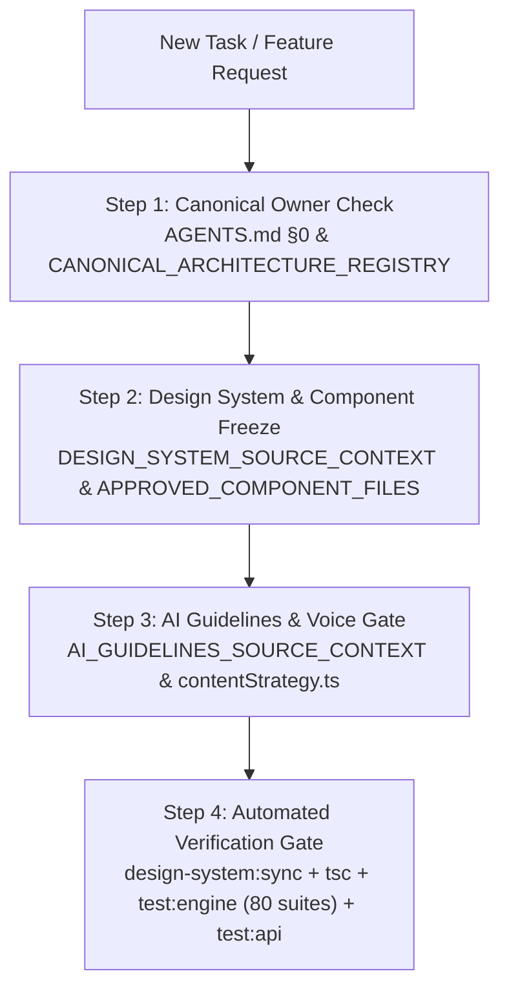

# Treise Continuous Governance, Starting-Point Protocol, Design System Freeze, AI Guidelines & SWOT Evaluation

This document establishes the permanent engineering starting point, Design System component governance, AI guideline linkage, QA pipeline, and system SWOT evaluation for **Treise** (synchronised with [`AGENTS.md`](file:///Users/benentaylor/Lift/AGENTS.md) and [`src/engine/governance.ts`](file:///Users/benentaylor/Lift/src/engine/governance.ts)).

---

## 1. Mandatory Starting Point for All New Work (Pre-Flight Source Context)

Every new task, feature, bug fix, or copy update MUST start from the single authoritative source context below before writing or modifying any code:



### 1.1 Rule A — Additive-First Canonical Architecture (`CANONICAL_ARCHITECTURE_REGISTRY`)
- Inspect [`AGENTS.md`](file:///Users/benentaylor/Lift/AGENTS.md) Section 0 (Rule #12) and `CANONICAL_ARCHITECTURE_REGISTRY` in [`src/engine/governance.ts`](file:///Users/benentaylor/Lift/src/engine/governance.ts).
- **One engine per domain:** Extend [`src/engine/e1rm.ts`](file:///Users/benentaylor/Lift/src/engine/e1rm.ts), [`src/engine/progressionRules.ts`](file:///Users/benentaylor/Lift/src/engine/progressionRules.ts), [`src/engine/progression.ts`](file:///Users/benentaylor/Lift/src/engine/progression.ts), [`src/engine/loadPersonalization.ts`](file:///Users/benentaylor/Lift/src/engine/loadPersonalization.ts), [`src/engine/continuityEngine.ts`](file:///Users/benentaylor/Lift/src/engine/continuityEngine.ts), [`src/engine/hypertrophyVolume.ts`](file:///Users/benentaylor/Lift/src/engine/hypertrophyVolume.ts), [`src/engine/recovery.ts`](file:///Users/benentaylor/Lift/src/engine/recovery.ts), [`src/engine/readiness.ts`](file:///Users/benentaylor/Lift/src/engine/readiness.ts), [`src/engine/kilgoreStandards.ts`](file:///Users/benentaylor/Lift/src/engine/kilgoreStandards.ts), [`src/engine/strengthStandards.ts`](file:///Users/benentaylor/Lift/src/engine/strengthStandards.ts), and [`src/engine/knowledgeGraph.ts`](file:///Users/benentaylor/Lift/src/engine/knowledgeGraph.ts) in place. Never create parallel calculators.
- **One canonical drill-in per domain object:** Every exercise entry point across Workout, Program, Progress, and AI Coach must open [`src/components/train/ExerciseDetailModal.tsx`](file:///Users/benentaylor/Lift/src/components/train/ExerciseDetailModal.tsx) backed by `buildInspectExerciseSession` / `buildExerciseDetailModel` in [`src/services/exerciseDetails.ts`](file:///Users/benentaylor/Lift/src/services/exerciseDetails.ts). Every exercise swap flow must open [`src/components/train/ExerciseSwapModal.tsx`](file:///Users/benentaylor/Lift/src/components/train/ExerciseSwapModal.tsx) backed by `recommendExerciseSwaps`.

### 1.2 Rule B — Using Existing Components from the Design System & No New Components Without Permission (`DESIGN_SYSTEM_SOURCE_CONTEXT` & `APPROVED_COMPONENT_FILES`)
- **Mandatory Design System source context** (`AGENTS.md` Rule #13):
  1. **Semantic Tokens:** [`src/styles/tokens.css`](file:///Users/benentaylor/Lift/src/styles/tokens.css) and [`src/styles/semanticTokens.ts`](file:///Users/benentaylor/Lift/src/styles/semanticTokens.ts) — use semantic CSS variables (`--color-bg-canvas`, `--color-bg-surface`, `--color-bg-surface-raised`, `--color-text-primary`, `--color-text-secondary`, `--color-text-muted`, `--color-action-primary-bg`, `--color-action-secondary-bg`, `--color-status-positive`, `--color-status-warning`, `--color-status-danger`, `--color-data-telemetry`). Raw hex (`#...`) and raw `rgba(...)` literals are banned in `src/components/` (enforced by Engine Suite 47).
  2. **CSS Primitives & 4-Size × 4-Weight × 3-Ink Typography Scale:** [`src/index.css`](file:///Users/benentaylor/Lift/src/index.css) — use `.wk-card`, `.wk-raised`, `.wk-pill` (strictly for non-interactive informational badges, never on `<button>`), `.wk-button`, `.wk-btn-secondary`, `.wk-field`, `.wk-segment`, `.wk-bar`, `.wk-chevron`, `.wk-tap`, and the 4 fixed typography tiers (`12px`: `.wk-label`, `.wk-meta-title`, `.wk-pill`, `.wk-segment`, `.wk-caption`; `16px`: `.wk-button`, `.wk-subhead`, `.wk-btn-secondary`, `.wk-field`, `.wk-body`; `20px`: `.wk-title`, `.wk-h1`, `.wk-nav-title`, `.wk-number`, `.wk-input`; `32px`: `.wk-page-title`, `.wk-display`).
  3. **Component Specifications & Live Catalog:** `TREISE_DESIGN_SYSTEM` in [`src/engine/knowledgeGraph.ts`](file:///Users/benentaylor/Lift/src/engine/knowledgeGraph.ts) and [`src/designSystem/DesignSystemApp.tsx`](file:///Users/benentaylor/Lift/src/designSystem/DesignSystemApp.tsx), synced to [`design-system.html`](file:///Users/benentaylor/Lift/design-system.html) via `npm run design-system:sync`.
- **No new components without explicit permission:**
  - All 58 approved files under `src/components/` are locked in `APPROVED_COMPONENT_FILES` ([`src/engine/governance.ts`](file:///Users/benentaylor/Lift/src/engine/governance.ts)).
  - Do **NOT** create any new file under `src/components/` (or introduce a new `.wk-*` class) without explicit user permission. Always compose or extend existing components.
  - Engine Suite 80 ([`src/engine/__tests__/singleEngineAndCanonicalUi.suite.ts`](file:///Users/benentaylor/Lift/src/engine/__tests__/singleEngineAndCanonicalUi.suite.ts)) compares the filesystem contents of `src/components/` against `APPROVED_COMPONENT_FILES` and fails CI immediately if any unapproved component file is added.

### 1.3 Rule C — All AI Features & Functionality Must Reference the Canonical AI Guidelines (`AI_GUIDELINES_SOURCE_CONTEXT`)
- Every AI prompt, deterministic fallback, tool response, or coaching surface (`AGENTS.md` Rule #14) MUST reference and validate against:
  1. **Content Strategy, Voice Matrix, Exercise Brief Blueprint & QA Gates:** [`src/engine/contentStrategy.ts`](file:///Users/benentaylor/Lift/src/engine/contentStrategy.ts) (`VOICE_TONE_MATRIX`, `EXERCISE_BRIEF_BLUEPRINT`, `buildExerciseBriefContractPrompt`, `runReadAloudQaGate`, `runRotContentAudit`, `CONTENT_SCHEMA_DICTIONARY`).
  2. **Surface Voice Guidelines & Personalization:** [`src/services/coachPersonalization.ts`](file:///Users/benentaylor/Lift/src/services/coachPersonalization.ts) (`buildSummaryVoiceGuidelines`, `checkSummaryVoiceGuidelines`, `normalizeSummaryVoice`, `buildPersonalizationPromptBlock`).
  3. **Numeric & Fact Grounding Checks:** [`src/services/factChecks.ts`](file:///Users/benentaylor/Lift/src/services/factChecks.ts) (`mismatchedWeightUnit`, `spelledNumberNotInFacts`, `mislabelledFigure`, `wasPromptRejected`, `markPromptRejected`).
  4. **Shared 2-Line Exercise Summary Builders:** [`src/services/exerciseInsight.ts`](file:///Users/benentaylor/Lift/src/services/exerciseInsight.ts) (`buildGoalDrivenLine1`, `buildGoalDrivenLine2`, `buildSwappedExerciseCopy`), shared with [`src/services/exerciseCoachNote.ts`](file:///Users/benentaylor/Lift/src/services/exerciseCoachNote.ts).
  5. **Screen Entry Hooks & 3-Tier OOUX Context Envelope:** [`src/services/coachContext.ts`](file:///Users/benentaylor/Lift/src/services/coachContext.ts) and [`src/services/coachContextEnvelope.ts`](file:///Users/benentaylor/Lift/src/services/coachContextEnvelope.ts).
  6. **Model Transport & 21 Deterministic OOUX Tools:** [`src/services/onDeviceModel.ts`](file:///Users/benentaylor/Lift/src/services/onDeviceModel.ts), [`src/services/deviceModels.ts`](file:///Users/benentaylor/Lift/src/services/deviceModels.ts), [`src/services/geminiFlashLite.ts`](file:///Users/benentaylor/Lift/src/services/geminiFlashLite.ts), [`api/coach/generate.ts`](file:///Users/benentaylor/Lift/api/coach/generate.ts), and [`src/services/coachTools.ts`](file:///Users/benentaylor/Lift/src/services/coachTools.ts).
- **The 6 Governed AI Generation Surfaces:**
  1. [`src/services/exerciseCoachNote.ts`](file:///Users/benentaylor/Lift/src/services/exerciseCoachNote.ts) — 2-line exercise card summary (`EXERCISE_BRIEF_BLUEPRINT`: Line 1 = Overall Progress Against Goals; Line 2 = Today's Action → Goal Outcome).
  2. [`src/services/identityMessage.ts`](file:///Users/benentaylor/Lift/src/services/identityMessage.ts) — Program tab identity message.
  3. [`src/services/workoutFinish.ts`](file:///Users/benentaylor/Lift/src/services/workoutFinish.ts) — Workout finish summary.
  4. [`src/services/progressOverview.ts`](file:///Users/benentaylor/Lift/src/services/progressOverview.ts) — Progress goals overview & goal card summaries.
  5. [`src/services/compositionOverview.ts`](file:///Users/benentaylor/Lift/src/services/compositionOverview.ts) — Body composition recomposition summary.
  6. [`src/services/aiAssistantService.ts`](file:///Users/benentaylor/Lift/src/services/aiAssistantService.ts) — Conversational AI Coach.

---

## 2. System Evaluation: Strengths, Weaknesses, Opportunities & Risks (SWOT)

This evaluation is codified in `SYSTEM_SWOT_EVALUATION` inside [`src/engine/governance.ts`](file:///Users/benentaylor/Lift/src/engine/governance.ts) and verified by Engine Suite 80.

### 2.1 Strengths (Core Differentiators & Architectural Foundations)
1. **Single-Source Deterministic Exercise Science & Load Continuity (`swot-s1-deterministic-exercise-science`)**
   - *Evidence:* RIR-adjusted Epley E1RM with `>12` rep halving and `1.18x` DB / `1.20x` RDL / calisthenic multipliers ([`src/engine/e1rm.ts`](file:///Users/benentaylor/Lift/src/engine/e1rm.ts)), rep-range Double Progression ([`src/engine/progressionRules.ts`](file:///Users/benentaylor/Lift/src/engine/progressionRules.ts)), Cross-Environment Continuity bridging ([`src/engine/continuityEngine.ts`](file:///Users/benentaylor/Lift/src/engine/continuityEngine.ts)), Israetel/Schoenfeld hypertrophy volume landmarks with `0.5x` synergist credit ([`src/engine/hypertrophyVolume.ts`](file:///Users/benentaylor/Lift/src/engine/hypertrophyVolume.ts)), unified local muscle recovery + systemic Amber Shield readiness ([`src/engine/recovery.ts`](file:///Users/benentaylor/Lift/src/engine/recovery.ts), [`src/engine/readiness.ts`](file:///Users/benentaylor/Lift/src/engine/readiness.ts)), and published Kilgore/Poliquin/Grindem strength & symmetry standards ([`src/engine/kilgoreStandards.ts`](file:///Users/benentaylor/Lift/src/engine/kilgoreStandards.ts), [`src/engine/strengthStandards.ts`](file:///Users/benentaylor/Lift/src/engine/strengthStandards.ts)) each have a single canonical module verified across 80 automated engine suites.
2. **Zero-Hallucination Hybrid AI with Fact-Based Fallbacks & QA Gates (`swot-s2-zero-hallucination-hybrid-ai`)**
   - *Evidence:* All 6 AI surfaces pair on-device Gemini Nano (`LanguageModel`) and stateless `gemini-3.5-flash-lite` inference with deterministic fact builders (`buildGoalDrivenLine1`, `buildGoalDrivenLine2`, `buildSwappedExerciseCopy`), pre-render numeric/unit verification ([`src/services/factChecks.ts`](file:///Users/benentaylor/Lift/src/services/factChecks.ts)), `runReadAloudQaGate`, and `checkSummaryVoiceGuidelines`. All 21 state mutations execute deterministically through [`src/services/coachTools.ts`](file:///Users/benentaylor/Lift/src/services/coachTools.ts) with `CoachStateDiff` receipts, HITL confirmation gates, and 1-tap Undo.
3. **Shift Nudge × Apple HIG Design System & Unified Canonical UI Surfaces (`swot-s3-shift-nudge-design-system-and-canonical-ui`)**
   - *Evidence:* A locked 4-Size (`12 / 16 / 20 / 32px`) × 4-Weight (`400 / 500 / 600 / 700-at-32px`) × 3-Ink (`1.00 / 0.78 / 0.60`) typography scale, semantic CSS tokens, `>=44px` touch targets, invariant logging table headers (`SET | PREV | WEIGHT | REPS | RIR | DONE`), and single canonical drill-in/swap/chart components (`ExerciseDetailModal`, `ExerciseSwapModal`, `TrendChart`) across Workout, Program, and Progress prevent visual fragmentation.
4. **Zero-Latency Local-First Persistence & Privacy-Preserving Architecture (`swot-s4-local-first-resilience-and-privacy`)**
   - *Evidence:* Immediate `usePersistedState` saves, cross-tab synchronization, quota-overflow cache eviction + `SAVE_FAILED_EVENT` alerts, automatic `v10` schema migrations, spreadsheet import, and stateless wearable/LLM proxies keep workout and biometric history exclusively on the athlete's device.

### 2.2 Weaknesses (Current Structural & Operational Friction Points)
1. **Historical Starting-Point Rule Truncation & Legacy Doc Drift — *Remediated* (`swot-w1-starting-context-truncation-and-doc-drift`)**
   - *Diagnosis:* `AGENTS.md` had accumulated 99.3 KB of historical prose, exceeding the `~23.8 KB` `<user_rules>` injection limit and truncating the bottom 76% of the file (where Design System and AI details sat), while legacy docs retained pre-Shift-Nudge and Bubblewrap references.
   - *Remediation:* Consolidated `AGENTS.md` under `23,750` bytes with Rules #1–#14, the Starting-Point Pre-Flight Protocol, the Canonical Architecture Registry, and the SWOT summary in the untruncated window (enforced by Engine Suite 80).
2. **High Line Counts in Core Orchestrator & Test Files (`swot-w2-monolithic-orchestrator-files`)**
   - *Diagnosis:* Core orchestrators ([`src/App.tsx`](file:///Users/benentaylor/Lift/src/App.tsx), [`src/components/train/TrainTab.tsx`](file:///Users/benentaylor/Lift/src/components/train/TrainTab.tsx), [`src/services/aiAssistantService.ts`](file:///Users/benentaylor/Lift/src/services/aiAssistantService.ts), [`src/engine/knowledgeGraph.ts`](file:///Users/benentaylor/Lift/src/engine/knowledgeGraph.ts), and [`src/engine/__tests__/verifyEngine.ts`](file:///Users/benentaylor/Lift/src/engine/__tests__/verifyEngine.ts)) have large line counts that increase context overhead when editing.
   - *Mitigation:* Delegate new domain logic to pure service helpers (`exerciseDetails.ts`, `exerciseInsight.ts`) and modular test suites (`*.suite.ts`) rather than growing inline component code.
3. **Single-Device Browser Storage Without Automatic Off-Device Backup (`swot-w3-single-device-localstorage-bound`)**
   - *Diagnosis:* Storing data solely in on-device `localStorage` protects privacy and works offline, but clearing browser site data or losing a phone without exporting a JSON backup loses history.
   - *Mitigation:* `requestPersistentStorage` is invoked once workout history exists, and 1-tap JSON backup export/restore is available in Settings.
4. **Cross-Gym Pulley & Lever Ratio Variance on First Machine Swap (`swot-w4-uncalibrated-cable-and-machine-stacks`)**
   - *Diagnosis:* Commercial cable stacks and lever machines vary in pulley mechanical advantage (`1:1` vs `2:1`), so first-time machine swaps use `EFFORT_ONLY` opening-set calibration rather than an exact kilogram conversion.
   - *Mitigation:* Line 1 and Line 2 explicitly explain opening-set machine calibration, and `recalibrateSetsAfterSet1` auto-adjusts remaining sets once Set 1 RIR is logged.

### 2.3 Opportunities (High-Leverage Additive Enhancements)
1. **Zero-Knowledge Client-Side Encrypted Backup & Restore (`swot-o1-encrypted-opt-in-backup`)**
   - Extend [`src/services/storage.ts`](file:///Users/benentaylor/Lift/src/services/storage.ts) `exportAllData` / `importAllData` with optional client-side encrypted snapshots (passphrase/passkey or Android Auto Backup) without storing plaintext health data on servers.
2. **Google Health API OAuth Proxy for Web-Only Fitbit/Pixel Users (`swot-o2-google-health-web-oauth`)**
   - Complement the native Android TWA `HealthConnectBridge.kt` by wiring the Google Health Web API proxy in `api/` once Google Cloud credentials are provisioned, restoring direct web-browser sync after the Nov 2026 legacy Fitbit Web API sunset.
3. **Longitudinal 6-Week Cycle-Over-Cycle Progress Comparison (`swot-o3-block-over-block-mesocycle-comparison`)**
   - Leverage existing `planStartWorkouts`, `buildExerciseInsight`, and `calculateWeeklyMuscleVolumeBreakdown` to compare Cycle 1 vs Cycle 2 strength and volume gains inside existing `ProgressChartCard` and `ExerciseDetailModal` views without adding new chart components.
4. **Continued Modularization of `verifyEngine.ts` & Service Hooks (`swot-o4-modular-suite-extraction`)**
   - Continue extracting domain test suites (`*.suite.ts`) following the Suite 76–80 pattern so verification stays modular and easy to audit.

### 2.4 Risks (Technical, Platform & Product Risks + Active Mitigations)
1. **Upstream Model Behavioral Drift (`swot-r1-llm-model-drift`)**
   - *Risk:* Silent updates to `gemini-3.5-flash-lite` or Chrome Prompt API can shift tone, echo prompts, or invent figures.
   - *Active Mitigation:* Strict pre-render gates (`factChecks.ts`, `runReadAloudQaGate`, `checkSummaryVoiceGuidelines`) reject non-compliant text and fall back immediately to deterministic fact builders.
2. **Unapproved Component Creation or Shadow Engine Duplication (`swot-r2-ui-and-engine-sprawl`)**
   - *Risk:* Future feature work could introduce duplicate drill-in modals, off-scale typography, or parallel progression/summary calculators.
   - *Active Mitigation:* Automated CI enforcement via `CANONICAL_ARCHITECTURE_REGISTRY`, `APPROVED_COMPONENT_FILES` freeze, and Engine Suites 47, 79, and 80.
3. **Accidental Bubblewrap Regeneration Wiping Native Kotlin Bridges (`swot-r3-android-twa-bridge-overwrite`)**
   - *Risk:* Running `bubblewrap update/build` regenerates the Android project and deletes custom `HealthConnectBridge.kt` and `ScaleBridge.kt` native bridges; ML Kit GenAI also blocks background webview inference (`BACKGROUND_USE_BLOCKED`).
   - *Active Mitigation:* Build Android releases exclusively via `./gradlew bundleRelease` and verify native bridge integrity with `npm run verify:playstore`.
4. **Third-Party Wearable OAuth / Rate-Limit Failures (`swot-r4-wearable-api-outages`)**
   - *Risk:* External wearable APIs (Whoop / Google Health) can rate-limit, expire refresh tokens, or return partial telemetry on training days.
   - *Active Mitigation:* Gracefully degrade to local muscle recovery windows ([`src/engine/recovery.ts`](file:///Users/benentaylor/Lift/src/engine/recovery.ts)) and advisory readiness indicators so wearable outages never block a workout.

---

## 3. Automated CI Certification & Google Play Store Runbook

### 3.1 Full Verification Pipeline
Run before every commit:
```bash
export PATH="/usr/local/bin:$PATH" && npm run design-system:sync && npx tsc --noEmit -p . && npm run test:engine && npm run test:api && npm run build && npm run verify:playstore && ! grep -rEn "client_secret['\"]?[[:space:]]*[:=,][[:space:]]*['\"][A-Za-z0-9_-]{16,}" dist/assets && npm run test:local:e2e
```

### 3.2 Android 16 TWA Build (`com.headstrong.app`, Target SDK 36, Whoop Slate `#13181C`)
- **Digital Asset Links:** `public/.well-known/assetlinks.json` binds `com.headstrong.app` with `delegate_permission/common.handle_all_urls` and `delegate_permission/common.use_as_origin` (required for the Health Connect & BLE Scale postMessage channel).
- **Native Gradle Build (Never Bubblewrap):**
  ```bash
  ./gradlew bundleRelease
  ```
  Produces signed `app-release-bundle.aab` and `app-release-signed.apk` while preserving `HealthConnectBridge.kt` and `ScaleBridge.kt`.
