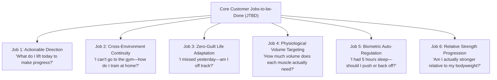

# HeadStrong Product Requirements Specification (PRS)

**Status:** Locked & Final 🔒  
**Version:** 1.0.0 (Production Canonical)  
**Governance Scope:** Entire Product Life Cycle  
**Mandate:** Authoritative functional and non-functional requirements based directly on verified customer needs. Future sessions must strictly adhere to this specification without regressing or altering locked features.

---

## 1. Executive Summary & Customer Mission

HeadStrong is an evidence-based, mobile-first Progressive Web App (PWA) and Android Trusted Web Activity (TWA) designed for serious natural hypertrophy lifters, hybrid gym/home athletes, and data-driven lifters utilizing wearable biometrics (Google Pixel Watch / Fitbit Web API).

### 1.1 The Customer Mission
> *"Deliver clear, zero-guesswork guidance from session to session: telling the lifter exactly what exercise, what weight, and how many reps to lift today to guarantee progressive overload—regardless of whether they train in a full gym, at home with dumbbells/TRX, or in a hotel room with bodyweight, and without punishing them when real life interrupts their schedule."*

---

## 2. Target Customer Personas & Problem Space

### 2.1 Persona Archetypes

| Persona | Description & Profile | Primary Friction Points in Existing Apps |
| :--- | :--- | :--- |
| **1. The Progressive Overload Lifter ("Marcus", 29)** | Intermediate-to-advanced lifter tracking progressive overload across mesocycles. Knows that progressive tension is king. | Existing apps (Strong, Hevy) are passive notebooks that show last week's numbers but don't prescribe today's target. RP Hypertrophy App requires \$35/mo and forces manual subjective soreness questionnaires. |
| **2. The Hybrid Athlete ("Elena", 34)** | Trains 2–3 days in a commercial gym, 1–2 days at home (dumbbells, adjustable bench, TRX), and travels occasionally. | Existing apps treat dumbbell and barbell variations as disconnected exercises, wiping progress history when swapping equipment or requiring multiple separate programs. |
| **3. The Data-Driven Lifter ("David", 41)** | Wears a Google Pixel Watch / fitness tracker. Stressed corporate job; sleep fluctuates between 5h and 8h. | Whoop/Athlytic give great recovery scores but offer zero lifting guidance. Lifting apps ignore biometric recovery completely, prescribing maximum intensity on days with depleted HRV and elevated resting heart rate. |

---

## 3. Jobs-to-be-Done (JTBD) Customer Needs Framework

### 3.1 Job 1: Instant Next-Action Direction ("What do I lift today to make progress?")
- **Customer Need:** The lifter steps onto the gym floor and needs to know their exact working weight and target reps in under 3 seconds without doing mental math or reviewing historical logs.
- **System Solution:**
  - Dedicated **"How to Make Progress This Session"** action checklist at the top of the Workout tab.
  - Per-exercise **Target Callout Box** displaying exact load and rep targets (e.g., `Target: 82.5 kg × 10 reps • +2.5 kg Weight Increase`).
  - Automated Double Progression algorithm advancing load when top of rep range is achieved or incrementing reps within the target zone.

### 3.2 Job 2: Cross-Environment Continuity ("I can't go to the gym—how do I train at home?")
- **Customer Need:** The lifter arrives home late or travels and cannot access a commercial barbell rack. They need equivalent dumbbell, TRX, or bodyweight exercises that preserve their progressive overload trajectory.
- **System Solution:**
  - 13 strict **Biomechanical Movement Families** guaranteeing equal stabilizer muscle demand and joint angles.
  - Mathematical **Cross-Implement Continuity Multipliers**:
    - Combined Dumbbell Weight Multiplier: $1.18\times$ Barbell Equivalent.
    - Romanian Deadlift (RDL) Multiplier: $1.20\times$ Conventional Deadlift Equivalent.
    - Pure Bodyweight Progression: Holds external load at $0\text{ kg}$, progresses via $+2$ reps (capped at 30), and prescribes 2-second paused stretch tempo cues.
  - **1-Tap Equipment Location Switcher** (`Full Gym | At Home | Travel`) instantly converting today's session while carrying over E1RM.

### 3.3 Job 3: Zero-Guilt Life Accommodation ("I missed yesterday—am I off track?")
- **Customer Need:** The lifter has an unexpected overtime shift, sick child, or poor sleep and misses Tuesday's workout. They must not be greeted with red "missed calendar day" warnings, broken streaks, or confusing schedule shifts.
- **System Solution:**
  - **Asynchronous Hypertrophy Queue**: Workouts are ordered in a physiological muscle-recovery rotation (`Push` → `Pull` → `Legs` → `Upper`), completely divorced from calendar days of the week.
  - If a day is skipped, the queued session waits with full glycogen and CNS recovery.
  - 1-tap **"Log Rest Day"** explicitly acknowledges rest, advances the calendar date, holds the current session at the front of the queue, and guarantees streak protection.

### 3.4 Job 4: Physiologically Accurate Volume Targeting ("How much volume does each muscle need?")
- **Customer Need:** The lifter needs to avoid overtraining fast-twitch, eccentric-damage-heavy muscles (Hamstrings, Chest) while ensuring high-endurance, low-axial muscles (Side Delts, Calves) receive adequate stimulus.
- **System Solution:**
  - Implementation of **Israetel & Schoenfeld Volume Landmarks** across 12 specific muscle groups:
    - Lateral Delts: MAV `16–26` sets/week (MRV `30+`).
    - Calves: MAV `16–24` sets/week (MRV `28+`).
    - Hamstrings: MAV `10–16` sets/week (MRV `18`).
    - Chest / Quads: MAV `12–18` sets/week (MRV `20`).
  - Secondary synergist credit ($0.5$ sets) for compound movements (e.g., Bench Press gives 1.0 Chest, 0.5 Triceps, 0.5 Front Delts).
  - Strict exclusion of warmup sets from hypertrophy volume tallies.

### 3.5 Job 5: Biometric Auto-Regulation ("I had 5 hours sleep—should I push or back off?")
- **Customer Need:** The lifter needs automatic, objective protection against overtraining and injury on low-recovery days without losing their streak or motivation.
- **System Solution:**
  - Rolling 14-day baseline Z-score calculation for HRV, RHR, and Sleep duration from Google Pixel Watch telemetry.
  - **Amber Shield Auto-Regulation Buffer ($Z \le -0.8$, HRV down $>15\%$, RHR $\ge +4\text{ bpm}$, or Sleep $<6\text{h}$):**
    - Overrides load increases: Holds working weight and reps constant.
    - Shifts target RIR to conservative $2–3$ reps in reserve.
    - Unconditionally protects streak and preserves workout XP.
  - **Primed State ($Z \ge +0.8$):** Rewards peak parasympathetic readiness with $+15\%$ XP bonus.

### 3.6 Job 6: Objective Relative Strength Progression ("Am I actually getting stronger?")
- **Customer Need:** The lifter wants to know if their strength gains are genuine rather than just an artifact of bodyweight fluctuations.
- **System Solution:**
  - Official International **DOTS Polynomial Formula** with separate male and female coefficients.
  - Daily bodyweight smoothing via **7-Day Exponential Moving Average (EMA)**:
    $$\text{EMA}_{\text{today}} = (\text{Weight}_{\text{today}} \times 0.25) + (\text{EMA}_{\text{yesterday}} \times 0.75)$$
  - Granular **6-Pillar Strength Standards** broken into 4 sub-divisions (`I, II, III, IV`) with exact reps needed at current working weight to rank up.

---

## 4. Functional Requirements Matrix

| Requirement ID | Module | Functional Description | Acceptance Criteria |
| :--- | :--- | :--- | :--- |
| **FR-TRAIN-01** | Workout | Asynchronous Hypertrophy Queue Recommendation | Always presents single "Up Next" workout with muscle recovery window and science rationale. Never shows competing day tabs. |
| **FR-TRAIN-02** | Workout | 1-Tap Location Adaptation | Switching between `Full Gym`, `At Home`, and `Travel` transforms all exercises in active session to matching equipment while translating working weights. |
| **FR-TRAIN-03** | Workout | Double Progression Engine | Hitting top of rep range advances load ($+2.5\text{ kg}$ Barbell, $+2.0\text{ kg}$ Dumbbell, $+2\text{ reps}$ Bodyweight). In-range advances reps by $+1$. Amber Shield holds load. |
| **FR-TRAIN-04** | Workout | Actionable Progress Checklist | Lists the top 1–2 weight or rep breakthroughs needed today. Displays live set completion progress bar and completed tonnage. |
| **FR-TRAIN-05** | Workout | In-Workout Set Management | 12-column aligned set table. 1-tap set completion with haptic feedback. Warmup sets excluded from volume tallies. 1-tap Undo for set deletion. |
| **FR-TRAIN-06** | Workout | Plate Calculator Modal | 1-tap plate breakdown for barbell exercises. Shows required plates per side with visual color rings. Touch target $\ge 44\text{px}$. |
| **FR-TRAIN-07** | Workout | Biomechanical Exercise Swap | 1-tap "Change Exercise" drawer filtered strictly by 13 movement families. Never cross-recommends incompatible muscle groups. |
| **FR-TRAIN-08** | Workout | Workout Summary & Gamification | Calculates session tonnage, duration, PR breakthroughs, XP earned, WCI stamina index, and displays next queued session. |
| **FR-PROG-01** | Program | Program Split Configuration | Supports 4 evidence-based splits: 4-Day PPL+Upper, 3-Day PPL, 4-Day Upper/Lower, 3-Day Full Body. Displays starter workouts. |
| **FR-PROG-02** | Program | Goal Phase Adjustment | Configures volume landmarks for `Lean Bulk` (MEV $\to$ MAV), `Cut / Recomp` (Retention Shield, $85\%$ volume), and `Maingain` (WCI density). |
| **FR-PROG-03** | Program | 6-Week Mesocycle Periodization | Week 1 Base Intro $\to$ Week 2 Accumulation $\to$ Week 3 Core $\to$ Week 4 Accretion $\to$ Week 5 Peak $\to$ Week 6 Deload. 1-tap Deload trigger. |
| **FR-PROG-04** | Program | Locations & Home Equipment Setup | Configures available home gear (Bench, Dumbbells, TRX, Pull-Up Bar, Bands) and updates exercise generation matrix. |
| **FR-PROG-05** | Program | Data Portability & Privacy | 1-tap JSON export, schema-validated JSON import, and 1-tap permanent data erasure (GDPR Right-to-be-Forgotten). |
| **FR-PROG-06** | Program | Competitor & Governance Matrix | In-app modal displaying locked vs. progressing features and benchmarks against RP, Fitbod, Hevy, and Whoop. |
| **FR-PROG-07** | Program | Custom Exercise Builder | Allows adding custom exercises locked to one of 13 canonical movement families. |
| **FR-PROG-08** | Program | Wearable Telemetry Sync Modal | Simulates or syncs Google Pixel Watch HRV, RHR, Sleep, AZM, and Steps. Evaluates daily readiness Z-score. |
| **FR-ANLY-01** | Progress | 2-Way Segmented View | Toggles between "Strength & Stamina" and "Recovery, Joints & Steps" to maintain visual hierarchy without scrolling fatigue. |
| **FR-ANLY-02** | Progress | Unified E1RM vs. Weight Chart | Plots 7-day EMA bodyweight against estimated 1-rep max trends across major movement pillars. |
| **FR-ANLY-03** | Progress | Work Capacity Index (WCI) Chart | Plots session tonnage per heart-rate reserve percentage over session duration. |
| **FR-ANLY-04** | Progress | Joint Health & Recovery Insights | Analyzes weekly volume against MRV limits and highlights potential joint strain risks. |
| **FR-ANLY-05** | Progress | Daily Weight Logging | Modal to log daily bodyweight with instant 7-day EMA smoothing calculation. |
| **FR-ATHL-01** | Athlete | Athlete Scorecard | Displays athlete name, level, 7-day EMA bodyweight, DOTS relative strength score, and combined Big 3 total. |
| **FR-ATHL-02** | Athlete | Weekly Muscle Volume Landmarks | Horizontal bar chart tracking weekly direct + synergist sets against MV, MEV, MAV, and MRV boundaries. |
| **FR-ATHL-03** | Athlete | 7-Pillar Strength Balance Radar | Radar visualization comparing relative strength across 6 movement pillars + Engine/Vitality pillar against international standards. |
| **FR-ATHL-04** | Athlete | Gamification Bonuses | Displays streak protection status and Metabolic Momentum multiplier ($1.25\times$ XP for $\ge 30$ AZM and $\ge 8{,}500$ steps). |
| **FR-ONBD-01** | Onboarding | 4-Step First-Time Wizard | Completes under 60 seconds: Welcome & Principles $\to$ Split Selection $\to$ Goal Phase $\to$ Gear Setup $\to$ Day 1 Delivery. |
| **FR-TENS-01** | Hardware | Google Pixel Tensor Detection | Queries Client Hints (`Sec-CH-UA-Model`), UA, and WebGL GPU vendor strings (`Mali-G720/G715/G710/G78`) to identify Google Pixel phone and Tensor generation (G1–G4). |
| **FR-TENS-02** | AI Engine | On-Device Tensor AI Coach | Executes daily coaching synthesis, tactical rep tempo, and autoregulation on-device via Chrome Built-in AI (Gemini Nano on Tensor TPU), WebNN, or WebGPU in $\le 15\text{ms}$. |
| **FR-TENS-03** | AI Engine | Tensor Biomechanical Matcher | Evaluates exercise substitution compatibility, joint torque, and stimulus-to-fatigue ratios on-device with zero cloud requests. |
| **FR-XP-01** | Gamification | Authoritative XP Economy & Progress Evaluation | Awards XP strictly for completed workouts (250 base + 50 all-sets bonus), mesocycle milestones (+200 week, +500 graduation), progressive overload breakthroughs (+60 load PR, +40 rep PR, +50 top of rep range), and strength standard promotions (+100 sub-tier, +350 major tier). |
| **FR-XP-02** | Gamification | Clean Slate & Zero Illegitimate XP Shield | Fresh installs start clean at Level 1, 0 XP, 0 streak, and 0 past logs. 13 non-training UI interactions (exercise swaps, split/location/week switches, wearable syncs, weight logging, JSON import/export, onboarding) are strictly prohibited from awarding XP. |
| **FR-LEAD-01** | Gamification | Privacy-First Opt-In Community XP Leaderboard | 1-tap opt-in/opt-out community leaderboard across 6 competitive divisions (Bronze to Elite). Dynamically places lifters by verified XP and displays rank gaps. Zero biometric, weight, or sleep logs shared. |

---

## 5. Non-Functional Requirements & Governance Constraints

### 5.1 Architecture & Performance
- **Local-First Zero Latency:** All workout logging, weight translations, and auto-regulation calculations execute locally in under $16\text{ms}$ with zero network roundtrip dependencies.
- **Offline PWA Reliability:** Full functionality via CacheFirst Service Worker precaching (`sw.js`). Operates seamlessly in gym basements without connectivity.
- **Platform Packaging:** Android 15 (SDK 35) Trusted Web Activity (TWA) compliance with complete Digital Asset Links binding (`assetlinks.json`).

### 5.2 Accessibility & Ergonomics
- **Touch Target Floor:** All interactive controls, icon buttons, and list items have a minimum touch target of $\ge 44\text{px} \times 44\text{px}$.
- **Typography Minimum Floor:** Strict $12\text{px}$ (`text-xs`) minimum font size across all screens. Zero micro-text (`text-[8px..11px]`) permitted anywhere in the product.
- **WCAG AA Contrast:** Obsidian `#060709` surface palette with minimum $4.5:1$ text contrast ratio.
- **Pinch-to-Zoom Enabled:** Viewport allows scaling up to $5.0\times$ for vision accessibility.

### 5.3 Legal, Safety & Privacy
- **Zero Medical Claims:** Explicit Non-Medical Fitness Disclaimer embedded in UI, `privacy.html`, and `terms.html`.
- **On-Device Data Sovereignty:** Biometrics and workout telemetry are stored exclusively in user's browser `localStorage`. No user health data is transmitted to third-party advertising or analytics networks.
- **Right to be Forgotten:** Dedicated "Delete All Data" control in settings permanently wipes all database entries.
