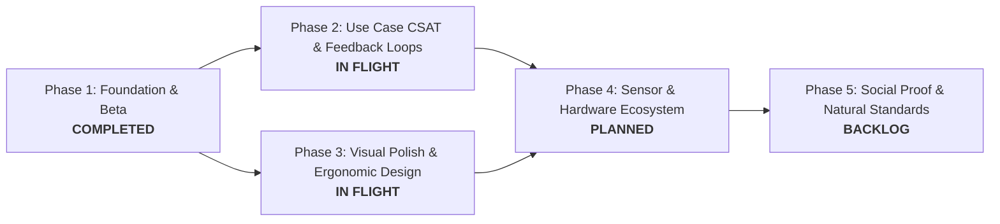

# Treise Product & Engineering Roadmap ⚡🛡️

**Living Document** • Maintained locally in repository root  
**Current Milestone:** Internal Play Store Beta & On-Device Testing  
**Target Release:** Production v1.0.0 (Google Play Store & PWA)

---

## 🗺️ Roadmap Overview & Strategic Pillars

The Treise roadmap aligns engineering and design efforts around our core mission: delivering zero-guesswork, evidence-based hypertrophy guidance that seamlessly adapts to real-life training environments and wearable biometrics.

---

## 🎯 Phase 1: Core Foundation & Internal Beta (Status: ✅ Complete)

- [x] **Exercise Science Engine:** RIR-adjusted E1RM, 7-day EMA bodyweight, official DOTS powerlifting polynomial, and 6-pillar strength standards with 4 sub-divisions.
- [x] **Biometric Auto-Regulation:** Z-score readiness computation from Google Pixel Watch (Fitbit Web API) and Whoop 4.0; Amber Shield streak protection.
- [x] **Cross-Platform Delivery:** PWA with service worker caching, Android TWA package (`com.treise.app`), Google Asset Links (`.well-known/assetlinks.json`).
- [x] **Vercel Cloud Backend & Auth:** Live deployment at `https://treise.vercel.app/`, Google Identity Services One-Tap sign-in, and Supabase database bridge.
- [x] **Internal Play Store Track:** Release keystore signed Android App Bundle (`app-release-bundle.aab`) deployed to Google Play Console Internal Testing track.

---

## 📊 Phase 2: Use Case CSAT & Customer Satisfaction Framework (Status: 🟡 Next Sprint)

Measure, evaluate, and iteratively optimize end-to-end Customer Satisfaction (CSAT) across the core user journeys:

### 2.1 In-App Micro-Feedback & Frictionless CSAT Prompts
- [ ] **Post-Workout Micro-Survey (1-Tap):**
  - Instant 5-star / emoji rating upon tapping "Finish Workout" (`Rate this session: Flow, Prescribed Loads, Rest Timers`).
  - Optional 1-tap chip tags: *"Pacing was perfect"*, *"Weights felt too heavy/light"*, *"Equipment swap was smooth"*, *"Timer was distracting"*.
  - Strict non-blocking design: Lifter can dismiss with a swipe or tap anywhere to review workout summary.
- [ ] **Milestone & Breakthrough CSAT Pulse:**
  - Prompt triggered on achieving a sub-tier level-up (e.g., Novice II → Novice III) or completing a 6-week mesocycle.
  - Measures satisfaction with progressive overload accuracy and motivation.

### 2.2 Journey-Specific CSAT Benchmarks & Instrumentation
- [ ] **Use Case 1: First-Time Onboarding & Setup CSAT (Target: >= 4.7 / 5.0):**
  - Measure drop-off and friction during athlete profile creation, equipment selection, and initial split recommendation.
- [ ] **Use Case 2: Live Workout Logging & Rest Timer HUD (Target: >= 4.8 / 5.0):**
  - Measure speed and physical ease of tapping sets with chalky hands, RIR selection accuracy, and rest timer transitions.
- [ ] **Use Case 3: Equipment Swap & Travel Continuity (Target: >= 4.6 / 5.0):**
  - CSAT validation when lifters switch from barbell to dumbbells, TRX, or hotel bodyweight without losing progress history.
- [ ] **Use Case 4: Wearable Biometrics & Auto-Regulation (Target: >= 4.7 / 5.0):**
  - Evaluate user trust in Amber Shield trigger recommendations (HRV/RHR/sleep dips) and Primed readiness XP bonuses.
- [ ] **Use Case 5: Asynchronous Schedule & Guilt-Free Recovery (Target: >= 4.8 / 5.0):**
  - Track satisfaction when workouts are skipped or shifted; verify lifters feel zero guilt or streak punishment.

### 2.3 Local Telemetry & Aggregation Dashboard
- [ ] **Privacy-Preserving CSAT Analytics:**
  - On-device local CSAT storage (`localStorage`/IndexedDB) with opt-in anonymized aggregation.
  - Admin/debug analytics view in Settings to visualize CSAT trends segmented by workout split and user tier.

---

## 🎨 Phase 3: Polished Designs & Ergonomic Elevation (Status: 🟡 Active Design Sprint)

Elevate the UI from functional engineering to a world-class, tactile luxury fitness product adhering to our **19 Codified Design Heuristics**:

### 3.1 Gym Floor Ergonomics & Thumb-Zone Optimization
- [ ] **One-Handed Operability (Bottom 60% Screen Rule):**
  - Reposition critical active workout controls (Set Log, RIR pills, Rest Skip, Load Steppers) strictly within the ergonomic natural thumb arc.
  - Eliminate top-of-screen reach during active exercise execution.
- [ ] **Generous Touch Targets & Physical Hitboxes:**
  - Upgrade all active gym controls to a minimum of `48×48px` (exceeding standard `44px` minimum) with tactile active press animations (`scale-95`).
  - Haptic feedback pulses (via Android `navigator.vibrate`) on set completion and rest timer countdown completion.

### 3.2 Visual Polish & Obsidian Theme Elevation
- [ ] **Dynamic Glassmorphism & Depth Layers:**
  - Refine Obsidian (`#060709`) surface layering with ultra-subtle borders (`border-white/[0.08]`), deep shadows, and subtle contextual accent glows (emerald for completed sets, amber for deload/fatigue warning, electric cyan for PRs).
  - High-performance GPU-composited CSS transforms preventing frame drops during high-speed scrolling.
- [ ] **Typography & Tabular Numerics Polish:**
  - Strict numerical tabular alignment (`font-mono tracking-tight font-variant-numeric: tabular-nums`) across all weights, reps, timers, and DOTS calculations to eliminate layout jitter.
  - Hierarchy cleanup: ensure maximum 2–3 typography sizes and weights per card, with an absolute floor of `12px` (`text-xs`).

### 3.3 Dynamic Micro-Interactions & Transitions
- [ ] **Fluid Set Completion Celebration:**
  - Micro-particles or smooth SVG path checkmark animation on set completion.
  - Floating "+25 XP" / "+50 XP" particle burst with gentle spring physics.
- [ ] **Floating Rest Timer Island:**
  - Compact, non-intrusive floating pill that expands gracefully into full timer controls with a smooth bottom sheet on tap.
  - Subtle radial countdown progress ring synchronized with simulated or real wearable recovery heart rate kinetics.
- [ ] **Smooth Page & Tab Transitions:**
  - View transition animations between tabs (Train, Character, Analytics, Program) with preserved scroll state and zero white flicker.

### 3.4 Data Visualizations & Radar Polish
- [ ] **High-Density Progress Charts:**
  - Smooth Bezier curves for E1RM progression and 7-day EMA bodyweight tracking with interactive cursor tooltips.
  - Work Capacity Index (WCI) area chart with shaded recovery zones.
- [ ] **7-Pillar Radar Elevation:**
  - Interactive radar chart with animated polygon vertices, tier threshold markers, and tapping a pillar displays current sub-tier quest details.

---

## ⌚ Phase 4: Sensor & Hardware Ecosystem Expansion (Status: 🔵 Planned)

- [ ] **WearOS Standalone Companion App:**
  - Direct WearOS companion tile for Pixel Watch 2 & 3: log sets, view target reps, and trigger vibration rest timers directly from the wrist.
- [ ] **Bi-Directional Health Connect Integration:**
  - Full read/write sync with Android Health Connect: write completed resistance workouts with caloric expenditure; read real-time heart rate and HRV.
- [ ] **Real-Time Bluetooth Heart Rate Monitor (BLE HRM):**
  - Direct Web Bluetooth connectivity to Polar H10, Garmin HRM-Pro, and Whoop bicep band for instant intra-set heart rate recovery monitoring.

---

## 🏆 Phase 5: Social Proof, Streaks & Natural Standards (Status: ⚪ Backlog)

- [ ] **Shareable Milestone Badges:**
  - Generate high-aesthetic Instagram/WhatsApp story cards celebrating 6-pillar tier promotions, 100-workout milestones, or DOTS breakthroughs.
- [ ] **Decentralized Leaderboard (Anonymous DOTS Index):**
  - Compare strength-to-bodyweight performance against verified natural lifters worldwide using the official international DOTS polynomial.
- [ ] **Mesocycle Export & Coach Share:**
  - Export completed mesocycle training logs and volume distributions as clean PDF or CSV reports.

---

## 📈 Roadmap Maintenance & Review Cadence

| Item | Schedule | Owner | Key Criteria |
| :--- | :--- | :--- | :--- |
| **CSAT Review** | Weekly | Product & Engineering | Address any journey scoring below 4.5/5.0 |
| **Heuristics Audit** | Bi-weekly | Design & UI Engineering | Audit all active components against the 19 Design Heuristics |
| **Release Bundles** | Bi-weekly | Mobile Release Lead | Sign and deploy updated `.aab` to Play Store tracks |
| **Roadmap Update** | Ongoing | Core Team | Keep status tags and checkbox completions current |
